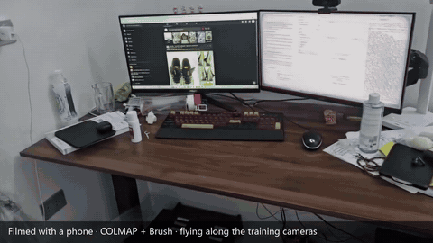
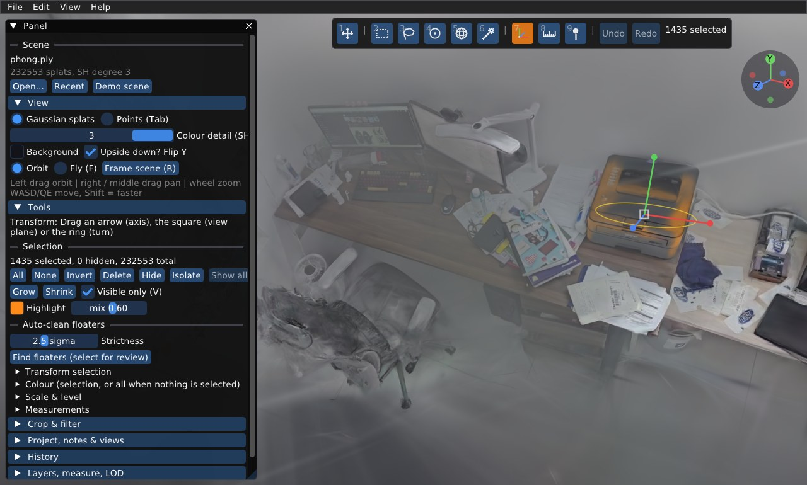
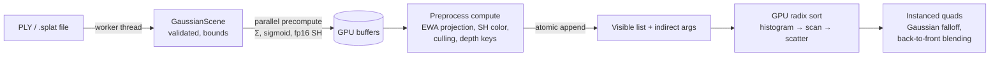
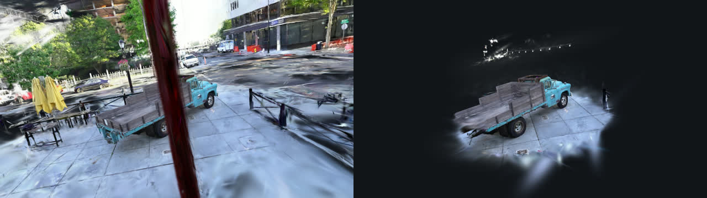
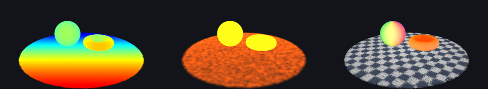
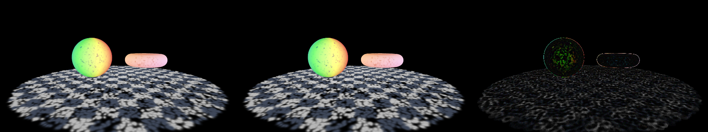

# gsplat-viewer

[](https://github.com/Tu-Nguyen-Dinh/gsplat-viewer/actions/workflows/ci.yml)
[](https://github.com/Tu-Nguyen-Dinh/gsplat-viewer/releases/latest)
[](LICENSE)

A real-time **3D Gaussian Splatting** viewer and editor written from scratch in **C++20 and
OpenGL 4.3**: EWA projection, view-dependent color with spherical harmonics, and a stable radix sort
that runs entirely in compute shaders; on top of it, selection and editing tools, measuring, survey
coordinates and LiDAR layers, and an interface in English and Vietnamese. Every stage is
unit-tested against a CPU reference and validated against an independent renderer.



*A desk filmed with a phone (848×480 video), reconstructed with COLMAP + Brush, rendered by
gsplat-viewer along the path of the phone. 32-second demo video: see the
[latest release](https://github.com/Tu-Nguyen-Dinh/gsplat-viewer/releases/latest).*


**1 M Gaussians at 1920×1080: 8.7 ms per frame (115 FPS) on an RTX 3060** · phone video → 3D scene at 30.3 dB · 142 tests (120 CPU + 22 GPU) · 40.6 dB vs PlayCanvas splat-transform



*v2.0 editor on the phone capture above: one click (Flood) selects the printer, the gizmo moves it
(previewed on the GPU, applied as one undo step).*

## Highlights

- **From a phone video to a 3D scene** — `tools/capture.ps1 video.mp4` picks sharp frames
  (variance of the Laplacian), runs COLMAP and Brush, then opens the result on the first training
  camera. `--eval` renders every held-out photo with its exact pose and intrinsics: a room filmed
  with a phone scores 30.3 dB PSNR, 0.28 dB from what the trainer itself renders
  ([capture guide](docs/CAPTURE.md)).
- **Compact GPU format** — 24 bytes per splat (16-bit positions in Morton-ordered chunks, fp16
  scale/opacity/color, 32-bit smallest-three quaternion); a 2.5 M splat scene fits in 155 MB of GPU
  memory instead of 339 MB, images 56–60 dB from full precision.
- **Viewer** — opens on the dense subject of any scene (radial density profile), orbit and fly
  cameras, 16-bit float blending (+0.35 dB over the 8-bit window on real scenes), box/sphere
  editing with undo, PLY export, `.ply` / `.splat` / `.spz` v2–4 input (gzip decoder written from
  the RFCs, zstd vendored).
- **EWA splatting on the GPU** — 3D covariance from scale + quaternion, perspective Jacobian with
  clamping, eigen-decomposition into oriented screen-space ellipses ([math](docs/MATH.md)).
- **GPU radix sort** — stable LSD sort (4-bit digits, per-block histograms, two-level Blelloch scan,
  packed Hillis–Steele ranking). The element count stays on the GPU; drawing is indirect, so the CPU
  never waits. 1 M keys in 2.5 ms (1.25 ms with 16-bit keys) vs 60 ms for `std::sort`.
- **Spherical harmonics up to degree 3**, stored as float16: preprocessing 4.1× faster than float32
  with no visible change (image PSNR unchanged at 54.4 dB).
- **Correctness first** — a CPU reference renderer implementing the same algorithm (GPU matches it at
  54.4 dB PSNR), GPU-vs-CPU checks of every projected splat (center error 1e-4 px), numerical-Jacobian
  tests, exhaustive float16 tests, and a script comparing against an independent renderer.
- **Engineering** — hand-written GL loader, RAII GPU resources, shader hot-reload with `#include`,
  asynchronous scene loading, invalid-data filtering, benchmark mode with CSV output, turntable export.

## Editor (v2.0)

Interactive tools on the 3D view, keys 1–9 ([docs/core/CORE5-editing.md](docs/core/CORE5-editing.md)):

- **Selection** — rectangle, lasso, screen brush, 3D sphere brush on the surface under the cursor, and
  one-click **Flood** (region growing against the region's mean colour, gap scaled to the measured
  splat spacing); Shift / Alt / Shift+Alt add, subtract, intersect; grow / shrink by one layer;
  "visible only" drops splats hidden behind a nearer surface (expected-depth test).
- **Transform gizmo** — move along an axis or the view plane, turn on a ring; spherical harmonics are
  rotated exactly (least-squares per band, colour error 2.7·10⁻⁷); while dragging, the GPU draws the
  selection moved (μ' = Aμ, Σ' = AΣAᵀ, SH evaluated at Rᵀ·d) without touching the data.
- **Undo / redo, unlimited** — commands store only the splats they change (bit-exact), big steps go to
  disk (deleting 2 M splats keeps ~8 MB in memory); History panel to jump to any step.
- **Cleanup** — floater candidates by statistical outlier removal (+ training-camera visibility), selected
  for review: 200/200 found, 0 false positives on the test scene; colour adjustments on the SH.
- **Measure and annotate** — distance, polyline, area, height; real scale from a known length, level from
  a selected floor; notes pinned in 3D with their view; `.gsvproj` project file, CSV.

## Usability (v2.0)

([docs/core/CORE6-ux.md](docs/core/CORE6-ux.md))

- Menu bar, icon tool bar, status bar, welcome screen with recent files and thumbnails, native Open / Save
  dialogs, a 5-step first-run tour, F1 shortcut sheet.
- **English / Tiếng Việt** (switches without restart; 409 strings checked for printf specifiers and font
  glyph coverage), DPI scaling, settings that survive a restart.
- **No lost work** — autosave with crash recovery (tested by killing the process mid-edit), Save / Don't
  save / Cancel before anything discards changes, background saving.
- Smooth camera transitions, axis compass and quick views, frame the selection, automatic render scale
  while moving.
- Export: pictures up to 4K, a video along saved views (H.264 via ffmpeg), an HTML report with the
  measurements and a picture of each note.

## Core library (v2.0)

The renderer is becoming a reusable core for VR, AR, survey and film tools
([docs/core/INDEX.md](docs/core/INDEX.md)):

- **Real-world coordinates** — double-precision Sim(3) frames; layers are rendered relative to a
  nearby origin, so survey coordinates (10⁶ m) keep millimetres (float alone: 3 cm error).
- **Point clouds with splats** — LAS 1.2–1.4 reader/writer (formats 0–10), opaque point layers that
  occlude splats through the depth buffer (`--las scan.las`).
- **Per-pixel depth from splats** — the depth of each Gaussian along the pixel ray (conditional mean
  from its screen-space covariance), for picking and measuring: 0.06 % error on a splat floor (`M` key).
- **Geometry** — kd-tree, PCA normals, Horn/Umeyama similarity with RANSAC, point-to-plane ICP
  (0.3 mm / 0.005° on two noisy scans), RANSAC planes.
- **Level of detail** — Morton octree with moment-matching merges and a budgeted cut: a third of
  the splats renders at 43 dB from the full scene (`--lod N`).
- **C API** — `include/gsv/gsv.h` + `libgsplat_capi` (38 functions, C99), headless rendering.
- **Headless GPU tests** — EGL surfaceless fallback: every GPU test also runs on Mesa llvmpipe in CI.

## Pipeline



| Stage | 1 M splats, 1080p | Bound by |
|---|---:|---|
| Preprocess (decode + projection + SH) | 0.53 ms | memory bandwidth |
| GPU radix sort (24-bit keys) | 1.78 ms | shared-memory ranking |
| Draw (132 M fragments, ~57 layers/pixel, fp16 blending) | 6.21 ms | blend rate |

## Quick start (Windows)

1. Download `gsplat-viewer-<version>-win64.zip` from [Releases](https://github.com/Tu-Nguyen-Dinh/gsplat-viewer/releases/latest) and unzip it (no installer, no DLLs).
2. Run `gsplat_viewer.exe`: the welcome screen offers Open, the demo scene and your recent files
   (View > Language > Tiếng Việt for Vietnamese).
3. Or drag a 3DGS `.ply` / `.splat` / `.spz` file onto the window; if it shows upside down, tick
   *Upside down? Flip Y* (remembered for that file).

## Android (in progress)

The same renderer runs on phones with OpenGL ES 3.1+ (NativeActivity, no Java): virtual joysticks
to walk through a scene, and a PC workflow where the phone uploads a video from its browser to
`gsplat_server`, the PC trains it, and the app downloads the result. Built without Gradle by
`tools/build_android.ps1`; every shader is checked as GLSL ES 3.10 on CI. See
[docs/ANDROID.md](docs/ANDROID.md).

## Build

Requirements: CMake ≥ 3.24, a C++20 compiler (tested with MinGW-w64 GCC 15.2), an OpenGL 4.3 GPU.
GLFW, GLM and Dear ImGui are fetched by CMake; GL headers and `stb_image_write` are vendored.

```bash
cmake -S . -B build -G "MinGW Makefiles" -DCMAKE_BUILD_TYPE=Release   # omit -G for Visual Studio
cmake --build build -j 8
ctest --test-dir build --output-on-failure
```

## Usage

```bash
build/gsplat_viewer                          # welcome screen (open, recent files, demo scene)
build/gsplat_viewer scan.ply --flip-y        # 3DGS training output (COLMAP scenes are Y-down)
build/gsplat_viewer scene.splat              # antimatter15 .splat
build/gsplat_viewer --gen demo.ply 1000000   # write a procedural scene
build/gsplat_viewer demo.ply --bench --size 1920x1080 --csv docs/benchmarks.csv
build/gsplat_viewer demo.ply --turntable frames/ --frames 72
build/gsplat_viewer demo.ply --view overdraw --screenshot overdraw.png
build/gsplat_viewer room.ply --eval          # PSNR/SSIM on the held-out photos (needs the COLMAP model)
build/gsplat_viewer truck.splat --flip-y --crop-sphere -0.57,-0.6,-0.4,3.2 --save-edited truck_only.ply
```

`.spz` (Niantic) versions 2-4 load directly: versions 2-3 with a gzip/DEFLATE decoder written for
this project from RFC 1951/1952 (no zlib), version 4 with the vendored zstd decoder. Decoded values
match splat-transform's decoder exactly. Other formats (`.sog`, `.ksplat`, ...) convert with
`npx @playcanvas/splat-transform in.sog out.ply`.

| Input | Action |
|---|---|
| Orbit mode: left / right or middle mouse / wheel | Orbit / pan / zoom |
| Fly mode: left or right mouse / middle mouse / wheel | Look around / pan / speed |
| W A S D, Q E (+Shift) | Move (fly mode: Q/E straight down/up) |
| 1 … 9 | Tools: Navigate, Rect, Lasso, Brush, Sphere, Flood, Transform, Measure, Note |
| Shift / Alt (+ select) · = / - · V | Add / subtract · grow / shrink · visible only |
| Delete · H / Alt+H · I | Delete · hide / show all · isolate the selection |
| M, then click two points | Measure (polyline, area, height in Tools > Measurements) |
| F · R · Shift+R · Num 1/3/7 | Orbit ↔ fly · frame the scene · frame the selection · quick views |
| Ctrl+Z / Ctrl+Y · Ctrl+S · F1 | Undo / redo · save the project · all shortcuts |
| Tab · C · F5 | Splats ↔ points · next training camera · reload shaders |

The camera opens on the dense subject of the scene (the radial density profile ignores background
and floaters), or on the first training camera when a COLMAP model sits next to the file.
The UI exposes sort mode and depth-key precision (16 / 24 / 32 bits), blending precision
(8-bit, 10-bit, 16-bit float), SH degree, oriented vs square quads, viewport culling and debug
views (depth, overdraw, ellipse outlines).

**Editing** (Edit panel or command line): select with a box or a sphere, delete inside or crop,
filter nearly transparent or oversized splats, undo, and save a standard 3DGS PLY
(checked: it reloads bit-exact and PlayCanvas splat-transform renders it at 45 dB from ours).



On a scene captured from inside a room, the simple filters are not floater detectors: the
large splats are the walls (removing the 1 406 splats larger than 1 unit drops the held-out
PSNR from 30.3 to 14.8 dB), so `--eval` is the way to check an edit.



## Performance

RTX 3060, i5-12400F, 1920×1080 offscreen, 240-frame orbit after warm-up, frame time = median
interval; default settings: compressed splats, 24-bit sort keys, 16-bit float blending
([full table](docs/BENCHMARKS.md), [raw CSV](docs/benchmarks.csv)).

| Scene | Splats | Preprocess | Sort | Draw | Frame | FPS | GPU memory |
|---|---:|---:|---:|---:|---:|---:|---:|
| demo (SH degree 3) | 300 K | 0.17 ms | 0.68 ms | 1.82 ms | 2.77 ms | 361 | 45 MB |
| demo (SH degree 3) | 1 M | 0.53 ms | 1.78 ms | 6.21 ms | 8.73 ms | 115 | 149 MB |
| demo (SH degree 3) | 3 M | 1.47 ms | 5.27 ms | 18.05 ms | 24.91 ms | 40 | 447 MB |
| truck (Tanks and Temples) | 2.54 M | 0.49 ms | 4.13 ms | 6.17 ms | 10.97 ms | 91 | 155 MB |

| Optimization | Before → after |
|---|---|
| GPU radix sort instead of CPU radix (1 M) | 13.8 ms → 2.5 ms |
| SH coefficient-major (coalesced loads), float16 (1 M) | 4.09 ms → 0.53 ms preprocess |
| 24-bit float depth keys, same image as 32-bit (truck) | 5.5 ms → 4.1 ms sort |
| Compressed splats, 24 B instead of 64 (truck) | 339 MB → 155 MB, preprocess 0.80 → 0.49 ms |
| Opacity-aware quad size (truck) | 245 M → 180 M fragments, same image |
| Oriented quads instead of squares (1 M) | 293 M → 132 M fragments (draw 1.18× faster) |
| Parallel scene precompute (12 threads) | 160 ms → 26 ms |

The 16-bit float blend target costs ~1.3 ms of draw time at 1 M splats (8-bit: `--blend rgba8`)
and buys 0.35 dB on real scenes; see [BENCHMARKS](docs/BENCHMARKS.md) for every trade-off.

## Validation

| Check | Result |
|---|---|
| GPU projection vs CPU (20 K splats) | max center error 1.2·10⁻⁴ px, conic 1.2·10⁻⁶ relative |
| GPU image vs CPU reference renderer | 54.4 dB (RGBA16F), 51.6 dB (RGBA8) |
| Unsorted image vs reference (the test must fail) | 22–24 dB |
| GPU radix sort vs `std::stable_sort` | identical, sizes 1 … 600 K, duplicates, 16-bit |
| vs PlayCanvas splat-transform | 40.6 dB on the demo, 45.0 dB on an edited scene saved as PLY ([script](tools/compare_with_splat_transform.ps1)) |



## Project layout

```
src/core/     math (EWA, SH), sorting, float16, parallelFor, image + PSNR, camera,
              geo frames, kd-tree, registration (Umeyama, ICP), picking,
              settings, translations (VI/EN), JSON                               — no OpenGL
src/gl/       GL loader (X-macro), shader programs, RAII buffers, framebuffers, GPU timers
src/scene/    scene data (SoA), PLY / .splat / .spz / LAS I/O, layers, LOD, demo scene,
              editing ops, edit history (undo), project file (.gsvproj)
src/render/   SplatRenderer, GpuRadixSort, CPU reference renderer, point renderer
src/app/      viewer: window, input, tools, menu / welcome / status bar, autosave,
              navigation, export, ImGui panel, CLI, benchmark / turntable modes
shaders/      GLSL 4.30 (preprocess, radix sort, scan, splat draw) + shared includes
tests/        142 CPU and GPU tests (custom runner, CTest) + a C99 test of the C API
include/gsv/  C API of the core (gsv.h); src/capi/ its implementation (libgsplat_capi)
tools/        capture pipeline, validation against splat-transform, UI test driver (Xvfb + XTest)
docs/         math notes, benchmarks, roadmap, docs/core/ (one page per core module)
```

## References

- Kerbl, Kopanas, Leimkühler, Drettakis — *3D Gaussian Splatting for Real-Time Radiance Field Rendering*, SIGGRAPH 2023
- Zwicker, Pfister, van Baar, Gross — *EWA Splatting*, IEEE TVCG 2002
- Blelloch — *Prefix Sums and Their Applications*, 1990
- [PlayCanvas splat-transform](https://github.com/playcanvas/splat-transform) — reference renderer for validation, `.splat` test fixture (MIT)

## License

MIT
