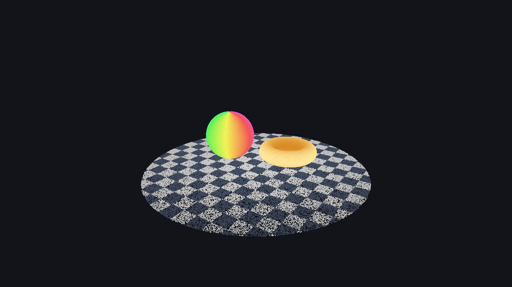

# gsplat-viewer

A real-time **3D Gaussian Splatting** viewer written from scratch in **C++20 and OpenGL 4.3**.
It loads scenes captured with a phone (or trained with the reference 3DGS code) and renders them interactively.

> Status: **Day 1 / 7** — PLY loading, camera, point rendering, GPU timing. See [docs/ROADMAP.md](docs/ROADMAP.md).



## Features

- [x] Binary PLY loader for the standard 3DGS layout (position, SH coefficients, opacity, scale, rotation), 2DGS files and plain point clouds
- [x] Hand-written OpenGL function loader (X-macro over `glcorearb.h`, no glad/GLEW)
- [x] Orbit / pan / fly camera, automatic framing with outlier-robust bounds
- [x] GPU timing with non-blocking `GL_TIME_ELAPSED` query ring
- [x] Shader hot-reload (F5) that keeps the last working shader on compile errors
- [x] Headless `--screenshot` mode for documentation and regression images
- [x] Procedural test scene generator (`--gen`)
- [ ] 3D covariance → 2D screen-space ellipse (EWA splatting) — *Day 2*
- [ ] Depth sorting + front-to-back alpha blending — *Day 3*
- [ ] View-dependent color (spherical harmonics up to degree 3) — *Day 4*
- [ ] GPU radix sort in compute shaders — *Day 4*
- [ ] Debug views, frustum culling, own phone scan — *Day 5*
- [ ] Benchmarks + validation against a reference renderer — *Day 6*

## Build

Requirements: CMake ≥ 3.24, a C++20 compiler (GCC/MinGW, Clang or MSVC), a GPU with OpenGL 4.3.
Dependencies (GLFW, GLM, Dear ImGui) are fetched automatically by CMake.

```bash
cmake -S . -B build -G "MinGW Makefiles" -DCMAKE_BUILD_TYPE=Release   # or omit -G for Visual Studio
cmake --build build -j 8
```

## Run

```bash
build/gsplat_viewer                         # built-in demo scene
build/gsplat_viewer scene.ply --flip-y      # INRIA / COLMAP scenes are stored Y-down
build/gsplat_viewer --gen demo.ply 300000   # write the demo scene as a 3DGS PLY
build/gsplat_viewer demo.ply --size 1280x720 --screenshot out.png
```

A `.ply` can also be dragged onto the window.

| Input | Action |
|---|---|
| Left mouse | Orbit |
| Right / middle mouse | Pan |
| Wheel | Zoom |
| W A S D / Q E (+Shift) | Move |
| F | Frame scene |
| F5 | Reload shaders |

## Project layout

```
src/
  main.cpp                 app loop, input, UI, command line
  camera.*                 orbit camera
  gl/gl_loader.*           OpenGL function loader (X-macro)
  gl/shader.*              shader program wrapper with hot-reload
  gl/gpu_timer.*           GPU timer queries
  gl/screenshot.*          framebuffer → PNG
  scene/gaussian_scene.h   scene data (structure of arrays)
  scene/ply_io.*           PLY reader / writer
  scene/demo_scene.*       procedural test scene
  render/point_renderer.*  Day 1 renderer
shaders/                   GLSL 4.30, hot-reloadable
docs/                      roadmap, benchmarks, notes
third_party/               Khronos GL headers, stb_image_write
```

## Performance

Measured with the GPU timer (render pass only, 1280×720). Full table in [docs/BENCHMARKS.md](docs/BENCHMARKS.md).

| Scene | Splats | Mode | GPU time | GPU |
|---|---:|---|---:|---|
| Demo | 300 000 | Points | 0.13 ms | RTX 3060 |

## References

- Kerbl et al., *3D Gaussian Splatting for Real-Time Radiance Field Rendering*, SIGGRAPH 2023
- Zwicker et al., *EWA Splatting*, IEEE TVCG 2002
- [PlayCanvas splat-transform](https://github.com/playcanvas/splat-transform) — used as a reference renderer to validate output

## License

MIT
