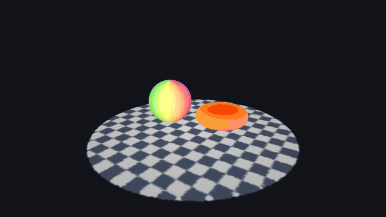
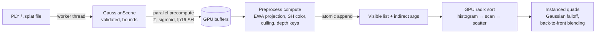

# gsplat-viewer

A real-time **3D Gaussian Splatting** renderer written from scratch in **C++20 and OpenGL 4.3**:
EWA projection, view-dependent color with spherical harmonics, and a stable radix sort that runs
entirely in compute shaders. Every stage is unit-tested against a CPU reference and validated
against an independent renderer.



**1 M Gaussians at 1920×1080: 8.4 ms per frame (119 FPS) on an RTX 3060** · 42 tests · 40.6 dB PSNR vs PlayCanvas splat-transform

## Highlights

- **EWA splatting on the GPU** — 3D covariance from scale + quaternion, perspective Jacobian with
  clamping, eigen-decomposition into oriented screen-space ellipses ([math](docs/MATH.md)).
- **GPU radix sort** — stable LSD sort (4-bit digits, per-block histograms, two-level Blelloch scan,
  packed Hillis–Steele ranking). The element count stays on the GPU; drawing is indirect, so the CPU
  never waits. 1 M keys in 2.5 ms (1.25 ms with 16-bit keys) vs 60 ms for `std::sort`.
- **Spherical harmonics up to degree 3**, stored as float16: preprocessing 4.1× faster than float32
  with no visible change (image PSNR unchanged at 54.4 dB).
- **Correctness first** — a CPU reference renderer implementing the same algorithm (GPU matches it at
  54.4 dB PSNR), GPU-vs-CPU checks of every projected splat (center error 1e-4 px), numerical-Jacobian
  tests, exhaustive float16 tests, and a script comparing against an independent renderer.
- **Engineering** — hand-written GL loader, RAII GPU resources, shader hot-reload with `#include`,
  asynchronous scene loading, invalid-data filtering, benchmark mode with CSV output, turntable export.

## Pipeline



| Stage | 1 M splats, 1080p | Bound by |
|---|---:|---|
| Preprocess (projection + SH) | 1.00 ms | memory bandwidth |
| GPU radix sort (32-bit keys) | 2.47 ms | shared-memory ranking |
| Draw (132 M fragments, ~57 layers/pixel) | 4.83 ms | fill rate |

## Build

Requirements: CMake ≥ 3.24, a C++20 compiler (tested with MinGW-w64 GCC 15.2), an OpenGL 4.3 GPU.
GLFW, GLM and Dear ImGui are fetched by CMake; GL headers and `stb_image_write` are vendored.

```bash
cmake -S . -B build -G "MinGW Makefiles" -DCMAKE_BUILD_TYPE=Release   # omit -G for Visual Studio
cmake --build build -j 8
ctest --test-dir build --output-on-failure
```

## Usage

```bash
build/gsplat_viewer                          # demo scene (300 K splats, SH degree 3)
build/gsplat_viewer scan.ply --flip-y        # 3DGS training output (COLMAP scenes are Y-down)
build/gsplat_viewer scene.splat              # antimatter15 .splat
build/gsplat_viewer --gen demo.ply 1000000   # write a procedural scene
build/gsplat_viewer demo.ply --bench --size 1920x1080 --csv docs/benchmarks.csv
build/gsplat_viewer demo.ply --turntable frames/ --frames 72
build/gsplat_viewer demo.ply --view overdraw --screenshot overdraw.png
```

Other formats (`.spz`, `.sog`, `.ksplat`, ...) convert with `npx @playcanvas/splat-transform in.spz out.ply`.

| Input | Action |
|---|---|
| Left mouse / right or middle mouse / wheel | Orbit / pan / zoom |
| W A S D, Q E (+Shift) | Move |
| F · Tab · F5 | Frame scene · splats ↔ points · reload shaders |

The UI exposes sort mode (none / CPU std::sort / CPU radix / GPU radix), 16-bit keys, SH degree,
oriented vs square quads, viewport culling and debug views (depth, overdraw, ellipse outlines).


## Performance

RTX 3060, i5-12400F, 1920×1080 offscreen, average of a 240-frame orbit after warm-up
([full table](docs/BENCHMARKS.md), [raw CSV](docs/benchmarks.csv)).

| Splats | Preprocess | Sort | Draw | Frame | FPS |
|---:|---:|---:|---:|---:|---:|
| 300 K | 0.35 ms | 0.89 ms | 1.42 ms | 2.75 ms | 364 |
| 1 M | 1.00 ms | 2.47 ms | 4.83 ms | 8.39 ms | 119 |
| 3 M | 2.83 ms | 7.06 ms | 14.13 ms | 24.10 ms | 41 |

| Optimization (1 M splats) | Before → after |
|---|---|
| GPU radix sort instead of CPU radix | 13.8 ms → 2.5 ms |
| SH stored as float16 | 4.09 ms → 1.00 ms preprocess |
| 16-bit depth keys | 2.47 ms → 1.25 ms sort |
| Oriented quads instead of squares | 293 M → 132 M fragments (draw 1.18× faster) |
| Parallel scene precompute (12 threads) | 160 ms → 26 ms |

## Validation

| Check | Result |
|---|---|
| GPU projection vs CPU (20 K splats) | max center error 1.2·10⁻⁴ px, conic 1.2·10⁻⁶ relative |
| GPU image vs CPU reference renderer | 54.4 dB (RGBA16F), 51.6 dB (RGBA8) |
| Unsorted image vs reference (the test must fail) | 22–24 dB |
| GPU radix sort vs `std::stable_sort` | identical, sizes 1 … 600 K, duplicates, 16-bit |
| vs PlayCanvas splat-transform | 40.6 dB ([script](tools/compare_with_splat_transform.ps1)) |


## Project layout

```
src/core/     math (EWA, SH), sorting, float16, parallelFor, image + PSNR, camera   — no OpenGL
src/gl/       GL loader (X-macro), shader programs, RAII buffers, framebuffers, GPU timers
src/scene/    scene data (SoA), PLY / .splat I/O, validation, async loading, demo scene
src/render/   SplatRenderer, GpuRadixSort, CPU reference renderer, point renderer
src/app/      viewer: window, input, ImGui panel, CLI, benchmark / turntable modes
shaders/      GLSL 4.30 (preprocess, radix sort, scan, splat draw) + shared includes
tests/        42 CPU and GPU tests (custom runner, registered with CTest)
tools/        validation against splat-transform
docs/         math notes, benchmarks, roadmap
```

## References

- Kerbl, Kopanas, Leimkühler, Drettakis — *3D Gaussian Splatting for Real-Time Radiance Field Rendering*, SIGGRAPH 2023
- Zwicker, Pfister, van Baar, Gross — *EWA Splatting*, IEEE TVCG 2002
- Blelloch — *Prefix Sums and Their Applications*, 1990
- [PlayCanvas splat-transform](https://github.com/playcanvas/splat-transform) — reference renderer for validation, `.splat` test fixture (MIT)

## License

MIT
